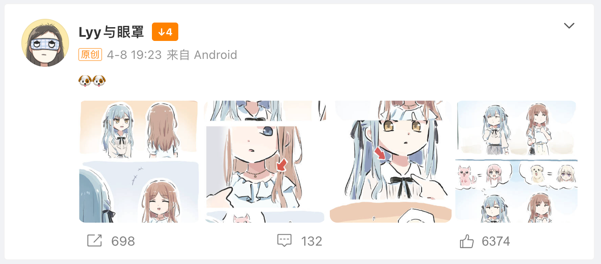
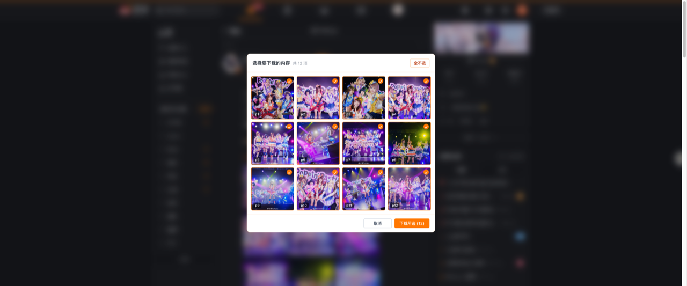

# 微博/X图片批量下载器

> 一键下载微博和X（原Twitter）帖子中的所有图片为原图，可选开启视频下载。

## 功能特性

- 一键下载当前帖子中的所有图片为原图
- 自动将缩略图/中图转换为高质量原图
- 微博 live photo 自动识别，默认自动合并为单文件 Motion Photo（`.MP.jpg`），受支持的相册/图片查看器可直接显示动态效果；也可关闭合并，回退为同时保存封面图和原始 `.mov`
- 微博 `gif` 仅下载 `.gif` 文件，不额外下载视频封装
- 默认微博混合媒体帖子会自动跳过纯视频项，保留其中可下载的图片项
- 可在油猴菜单中开启视频下载；开启后会同时下载当前帖子中的图片、GIF、Live Photo 和视频
- 微博视频默认选择接口可用清晰度中的最高质量；X 普通视频会优先使用页面直链，缺失时从帖子接口获取最高质量 MP4
- X 动图（GIF）默认在本地自动转换为真正的 `.gif`；可关闭转换，下载原始 `.mp4` 动图源
- 默认 X 纯视频帖子不显示下载按钮；同条内容里若仍有图片/GIF，则保留图片/GIF 下载按钮
- 批量下载支持，避免浏览器并发限制
- 下载失败时自动切换二进制兜底，不再退化为批量打开图片新标签页
- 支持动态加载内容（无限滚动）
- 文件命名包含帖子ID，方便整理

## 安装方法

### 方法1：Tampermonkey（推荐）

1. 安装 [Tampermonkey](https://www.tampermonkey.net/) 浏览器扩展
2. 点击 [dist/weibo-image-downloader.user.js](https://github.com/gbandszxc/weibo-image-downloader/raw/refs/heads/main/dist/weibo-image-downloader.user.js) 文件
3. 或者在 Tampermonkey 面板中选择"添加新脚本"
4. 将 `dist/weibo-image-downloader.user.js` 的内容粘贴进去并保存

### 方法2：Violentmonkey

1. 安装 [Violentmonkey](https://violentmonkey.github.io/) 浏览器扩展
2. 同样的方式添加脚本

## 使用方法

*下载按钮会显示为橙色 `↓N`，其中 `N` 表示当前帖子中可下载的媒体数量；默认只统计图片、GIF 和 Live Photo。页面会周期性复查帖子里的媒体元素，X 等站点媒体渐进加载时 `N` 会自动校正，列表页与详情页的计数保持一致。*

点击后按钮立即显示“下载中”，覆盖媒体解析、GIF 处理和下载的整个等待过程；同条帖子执行期间不能重复触发，其他帖子仍可下载。结束后短暂显示“完成”或“失败”，并保留结果 toast，然后恢复 `↓N`。长按选择时显示“选择中”，取消后恢复，确认后进入下载；也可用 Tab 聚焦按钮并按 Enter/空格下载全部。

下载中沿用普通按钮的橙底白字、字体和 20px 高度，仅替换文字并通过约 220ms 的缓出动画调整宽度；恢复时平滑收回。系统开启“减少动态效果”时直接切换宽度。

使用浏览器下载兜底时，按钮显示“已发起”，toast 提示查看浏览器下载列表；此时文件是否已保存由浏览器确认。

*长按下载按钮后会展开选择弹窗，可按媒体项勾选下载；普通图片显示为 `p1`、`p2`，Live Photo 显示为 `lp1`、`lp2`，动图显示为 `a1`、`a2`。开启视频下载后，视频显示为蓝色系 `v1`、`v2`。*

### 设置

在 Tampermonkey/Violentmonkey 的脚本菜单中点击 **“视频下载：[关闭/开启]”** 可切换视频下载。默认关闭，关闭时脚本行为与图片下载版本一致；切换后当前页面会立即刷新下载按钮状态。

点击 **“X平台GIF自动转换：[开启/关闭]”** 可切换 X 动图转换，默认开启，设置自动保存并立即对后续下载生效。开启时在本地解码 MP4 并编码为循环播放的 `.gif`，关闭时保留 `.mp4` 源文件。此设置独立于视频下载开关，不影响微博 GIF 或普通视频。转换保留源视频尺寸和完整时长（20 FPS 采样、每帧最多 256 色），失败时会提示失败，可关闭自动转换后重试下载 MP4 源文件；压缩、Worker 调度等实现细节与性能验证记录见 [技术细节](docs/TECHNICAL.md)。

点击 **“微博LivePhoto自动合并：[开启/关闭]”** 可切换微博 Live Photo 单文件合并，默认开启，设置自动保存并立即生效。开启时脚本把封面图与 `.mov` 视频在本地按字节合并为 Google/Samsung 兼容的单文件 Motion Photo（命名 `weibo_帖子ID_序号.MP.jpg`），Google 相册、三星相册、Windows 11 照片、ImageGlass 9.3+ 等支持的查看器可直接播放动态效果；不支持的查看器仍显示静态封面图。合并失败时自动回退为分别保存 `.jpg` 与 `.mov`。实现原理与兼容性说明见 [技术细节](docs/TECHNICAL.md)。

### 微博

1. 打开微博首页 https://weibo.com、移动端 https://m.weibo.cn/ 或任意微博页面
2. 浏览微博，找到包含图片的帖子
3. 在每条微博的下方（点赞/评论/转发按钮旁边）会出现一个橙色的 **"↓N"** 按钮
4. 点击按钮即可批量下载该条微博的所有图片
5. 长按按钮可按媒体项手动选择；微博 live photo 默认合并为单文件 Motion Photo（`.MP.jpg`），关闭“微博LivePhoto自动合并”后同时下载 `.jpg` 和 `.mov`
6. 默认纯视频微博不会显示图片下载按钮；`gif` 会按单个 `.gif` 媒体项处理
7. 开启视频下载后，纯视频微博也会显示下载按钮，点击会下载最高可用清晰度的视频

### X（原Twitter）

1. 打开X首页 https://x.com 或任意X页面
2. 浏览推文，找到包含图片的帖子
3. 在每条推文的发送时间右侧会出现一个橙色的 **"↓N"** 按钮
4. 点击按钮即可批量下载该条推文的所有图片
5. X 动图（GIF）默认自动转换并下载 `.gif`；关闭“X平台GIF自动转换”后下载 `.mp4` 动图源。默认纯视频帖子不会显示图片下载按钮
6. 开启视频下载后，普通视频会纳入下载；页面未暴露直链时脚本会从帖子接口获取最高质量 MP4

## 支持的页面

### 微博
- 微博首页 feed 流
- 用户主页
- 微博搜索结果页（weibo.com 及 s.weibo.com）
- 微博详情页
- 微博移动端首页 `m.weibo.cn/`
- 微博移动端用户主页 `m.weibo.cn/profile/...`
- 微博移动端搜索页 `m.weibo.cn/search`

### X（原Twitter）
- X首页 feed 流
- 用户主页
- 搜索结果页
- 推文详情页
- 图片/视频预览页（`/status/:id/photo/:n`、`/status/:id/video/:n`，按钮在右栏用户名右侧，下载该推文全部媒体）

## 文档

| 文档 | 说明 |
| --- | --- |
| [更新日志](docs/CHANGELOG.md) | 各版本变更记录 |
| [技术细节](docs/TECHNICAL.md) | 图片 URL 转换、下载策略、X 动图 GIF 转换实现与性能验证 |
| [常见问题](docs/FAQ.md) | 安装与下载的常见问题排查 |
| [开发指南](docs/DEVELOPMENT.md) | 构建、测试与发布流程说明 |
