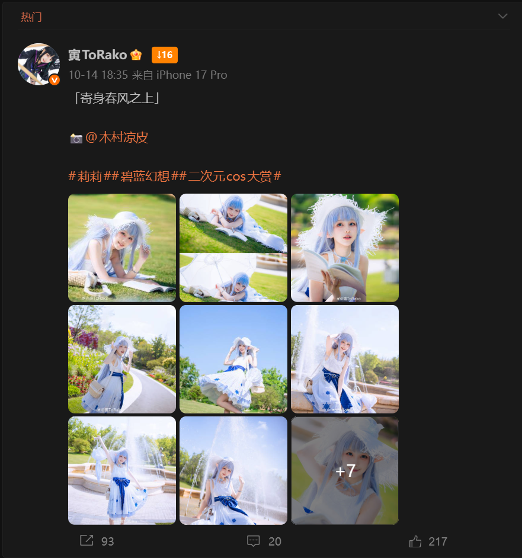

# 微博/X图片批量下载器

> 一键下载微博和 X（原 Twitter）帖子中的原图、GIF、Live Photo，也可按需开启普通视频下载。支持批量下载、按图选择和自定义文件名。

## 功能特性

- **原图批量下载**：自动获取微博、X 的高质量原图，支持整帖下载。
- **GIF 下载**：微博 GIF 直接保存为 `.gif`；X 动图默认在浏览器本地转换为真正的 `.gif`，也可关闭转换、保留原始 `.mp4`。
- **Live Photo 下载**：微博动态照片默认合并为单文件 Motion Photo（`.MP.jpg`），可在部分 Windows、Android 和 NAS 相册播放；也可保存为带 Apple 配对元数据的同名 `.jpg` + `.mov`。
- **可选视频下载**：普通视频默认不下载；开启后优先获取可用的高质量视频。
- **按需选择媒体**：点击 `↓N` 下载全部；长按或桌面端右键下载按钮，通过缩略图选择媒体。
- **自定义文件名**：支持平台、帖子 ID、序号、作者、原文件名等占位符。
- **其他特性**：支持动态加载、多任务并发、下载状态提示与失败回退。

> 默认下载图片、GIF 和 Live Photo，普通视频需在脚本菜单中手动开启。X GIF 转换在本地进行，大文件可能需要更多时间及内存。

## 安装方法

先安装 [Tampermonkey](https://www.tampermonkey.net/)（推荐）或 [Violentmonkey](https://violentmonkey.github.io/) 浏览器扩展，再选择安装来源：

- [Greasy Fork 安装页面](https://greasyfork.org/zh-CN/scripts/568598)
- [GitHub 最新构建脚本](https://github.com/gbandszxc/weibo-image-downloader/raw/refs/heads/main/dist/weibo-image-downloader.user.js)

若浏览器未自动跳转到脚本管理器，也可以新建脚本，粘贴 `dist/weibo-image-downloader.user.js` 的内容并保存。GitHub 与 Greasy Fork 的版本可能有短暂同步差异。

## 使用方法

*下载按钮会显示为橙色 `↓N`，其中 `N` 表示当前帖子中可下载的媒体数量；默认只统计图片、GIF 和 Live Photo。页面会周期性复查帖子里的媒体元素，X 等站点媒体渐进加载时 `N` 会自动校正，列表页与详情页的计数保持一致。*

点击后按钮立即显示“下载中”，覆盖媒体解析、GIF 处理和下载的整个等待过程；同条帖子执行期间不能重复触发，其他帖子仍可下载。结束后短暂显示“完成”或“失败”，并保留结果 toast，然后恢复 `↓N`。长按（桌面端也可右键）选择时显示“选择中”，取消后恢复，确认后进入下载；也可用 Tab 聚焦按钮并按 Enter/空格下载全部。右键选图仅响应鼠标，平板和手机等触屏设备只保留长按手势。

下载优先通过脚本管理器的下载通道保存，并尽量保留自定义文件名；不可用或失败时回退浏览器原生下载。回退时可能显示「已发起」而不是「完成」，请在浏览器下载列表确认结果。详见 [常见问题](docs/FAQ.md) 与 [技术细节](docs/TECHNICAL.md)。

*右键单击（或长按）下载按钮后会展开选择弹窗：每个媒体项以列表页同源的缩略图回显，普通图片直接显示缩略图，Live Photo 带 `LIVE` 角标，动图带 `GIF` 角标。缩略图始终为正方形；项目较多时弹窗高度随内容自适应，超出视口可用高度后改为网格内部滚动，头部标题与底部按钮固定不动。滚动条为覆盖式 3px 细条，无箭头、无轨道底色，仅在指针移入、滚动或拖动时淡入，其余场景完全隐藏；移动端可在网格内单指上下滑动。超过 9 项的帖子（如 12 图微博）按四列继续平铺，不会遗漏列表页被 `+N` 遮罩的图片。开启视频下载后，视频带「视频」角标与封面缩略图。*

### 设置

可在 Tampermonkey / Violentmonkey 的脚本菜单中调整：

| 选项 | 默认 | 说明 |
| --- | --- | --- |
| **视频下载** | 关闭 | 开启后将普通视频纳入可下载媒体 |
| **X平台GIF自动转换** | 开启 | 将 X 动图的 MP4 源在本地转换为 `.gif`；关闭则保留 `.mp4` |
| **微博LivePhoto自动合并** | 开启 | 保存为单文件 `.MP.jpg`；关闭则保存带 Apple 配对元数据的同名 `.jpg` + `.mov` |
| **文件命名设置** | `{platform}_{postId}_{index}` | 微博与 X 可分别设置模板，支持 `{author}`、`{source}` 等占位符 |
| **常见问题** | — | 打开 [FAQ](docs/FAQ.md) 查看下载及格式相关问题 |

X GIF 转换保留源尺寸和完整时长，转换失败时可关闭此功能重新下载原始 MP4。微博单文件 Motion Photo 支持部分 Windows、Android 与 NAS 相册；macOS / iOS 照片 App 请改用 JPG + MOV 配对文件并一起导入。详见 [LivePhoto 格式逆向与实现](docs/LIVEPHOTO.md) 和 [技术细节](docs/TECHNICAL.md)。

### 微博

1. 打开微博首页 https://weibo.com、移动端 https://m.weibo.cn/ 或任意微博页面
2. 浏览微博，找到包含可下载媒体的帖子
3. 在每条微博的下方（点赞/评论/转发按钮旁边）会出现一个橙色的 **"↓N"** 按钮
4. 点击按钮即可批量下载该条微博的所有可下载媒体
5. 长按按钮（电脑端也可右键）可按媒体项手动选择；微博 live photo 默认合并为单文件 Motion Photo（`.MP.jpg`），关闭“微博LivePhoto自动合并”后下载同名 `.jpg` 与 `.mov` 配对文件（注入 Apple Live Photo 元数据，一起导入 Apple 设备可作 Live Photo 播放）
6. 默认纯视频微博不会显示图片下载按钮；`gif` 会按单个 `.gif` 媒体项处理
7. 开启视频下载后，纯视频微博也会显示下载按钮，点击会下载最高可用清晰度的视频

### X（原Twitter）

1. 打开X首页 https://x.com 或任意X页面
2. 浏览推文，找到包含可下载媒体的帖子
3. 在每条推文的发送时间右侧会出现一个橙色的 **"↓N"** 按钮
4. 点击按钮即可批量下载该条推文的所有可下载媒体
5. X 动图（GIF）默认自动转换并下载 `.gif`；关闭“X平台GIF自动转换”后下载 `.mp4` 动图源。默认纯视频帖子不会显示图片下载按钮
6. 开启视频下载后，普通视频会纳入下载；页面未暴露直链时脚本会从帖子接口获取最高质量 MP4，也支持“只有部分账号可以回复”的视频帖

## 支持的页面

### 微博
- 微博首页 feed 流
- 用户主页
- 微博搜索结果页（weibo.com 及 s.weibo.com）
- 微博详情页
- 微博移动端首页 `m.weibo.cn/`
- 微博移动端用户主页 `m.weibo.cn/profile/...`
- 微博移动端搜索页 `m.weibo.cn/search`

### X（原Twitter）
- X首页 feed 流
- 用户主页
- 搜索结果页
- 推文详情页
- 图片/视频预览页（`/status/:id/photo/:n`、`/status/:id/video/:n`，按钮在右栏用户名右侧，下载该推文全部媒体）

## 文档

| 文档 | 说明 |
| --- | --- |
| [更新日志](docs/CHANGELOG.md) | 各版本变更记录 |
| [技术细节](docs/TECHNICAL.md) | 图片 URL 转换、下载策略、X 动图 GIF 转换实现与性能验证 |
| [LivePhoto 格式逆向与实现](docs/LIVEPHOTO.md) | 动态照片各家机制、真机逆向结论、A/B 实测证据与适配指南 |
| [常见问题](docs/FAQ.md) | 安装与下载的常见问题排查 |
| [开发指南](docs/DEVELOPMENT.md) | 构建、测试与发布流程说明 |
| [示例帖子](docs/EXAMPLES.md) | 长按选择弹窗与媒体解析的回归实测样本 |
